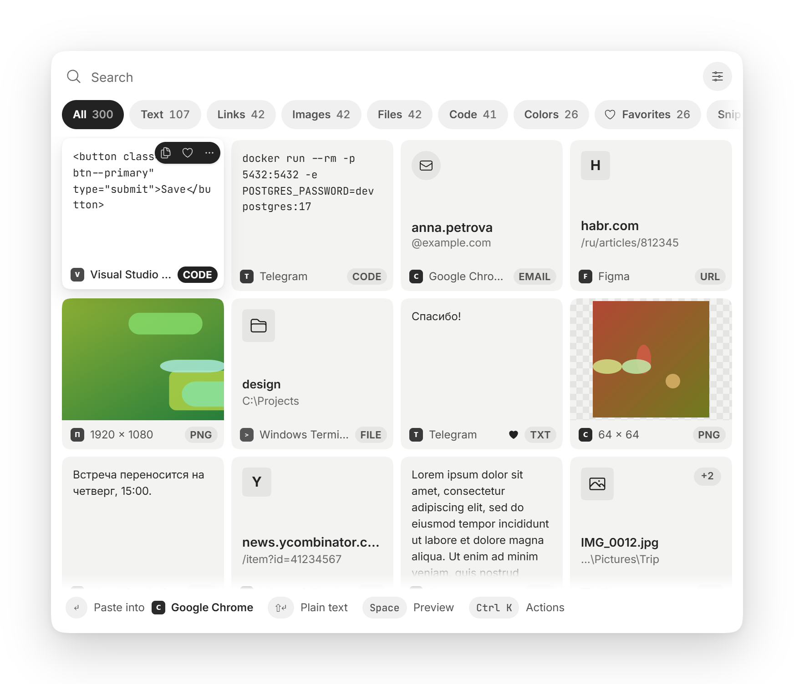
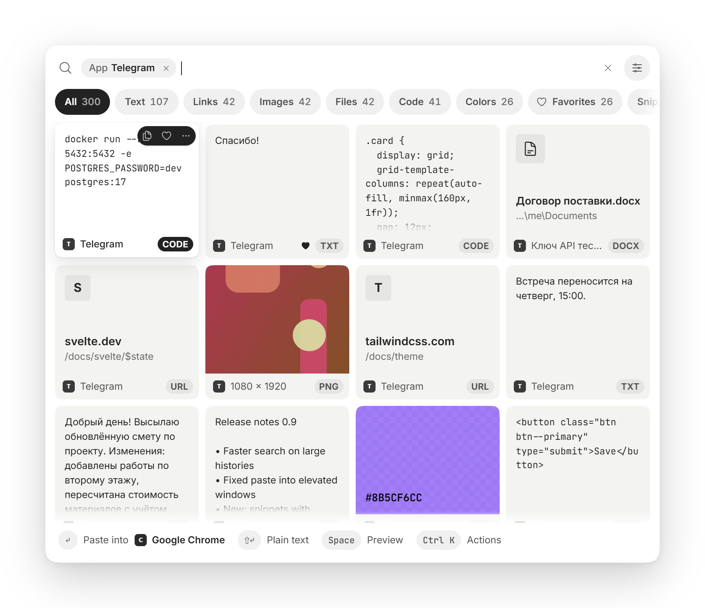
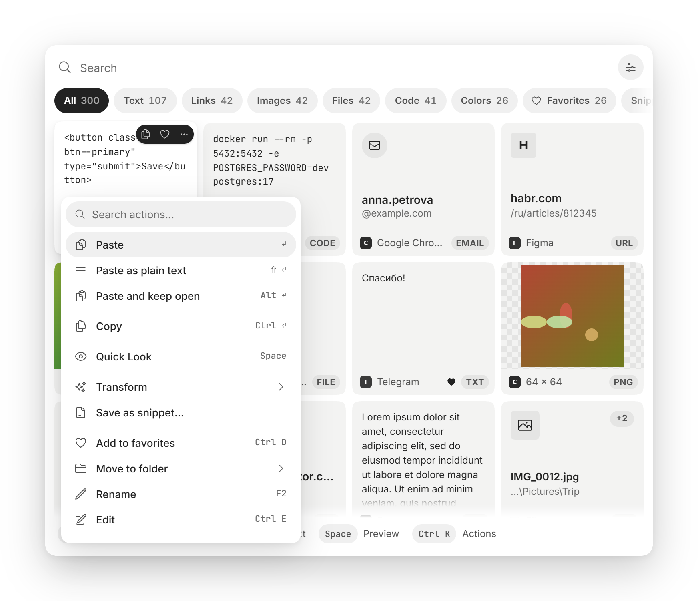

<div align="center">


# Liqlip

**A keyboard-first clipboard manager for Windows.**<br>
Everything you copy, one `Alt + V` away: searchable, private, and stored only on your PC.

[](LICENSE)
[](#install)
[](https://v2.tauri.app)
[](https://svelte.dev)
[](https://github.com/prodbyEDDY/liqlip/actions/workflows/ci.yml)

[Download](https://github.com/prodbyEDDY/liqlip/releases/latest) ·
[Features](#features) ·
[Shortcuts](#keyboard-shortcuts) ·
[Privacy](#privacy) ·
[Build from source](#build-from-source)

<br>

<picture>
  <source media="(prefers-color-scheme: dark)" srcset="docs/media/shelf-dark.png">
  
</picture>

</div>

## About

Liqlip keeps your clipboard history: text, links, code, colors, contacts, images and files. Press
`Alt + V` in any app and a monochrome shelf of cards opens over it. Start typing to search, or
use the arrow keys and press `Enter`. The item is pasted back into the window you were working
in, at the caret.

It is free, open source, and makes no network requests. Copies from password managers are never
recorded.

Liqlip started as the clipboard part of Liquid Tools and was rebuilt as a standalone,
clipboard-only app.

## Features

**Capture**
- Records every copy without polling, using the Windows clipboard listener. A hung source app
  can't freeze Liqlip.
- Seven kinds of items: text, links, code, colors, contacts, images and files. Rich formats
  (HTML, RTF, PNG, file lists) are kept, so you can later paste an item in a specific format.
- Global de-duplication: copying something again moves the existing card to the top instead of
  adding a duplicate.
- Remembers the source app with its icon, so you can filter by it.

**The shelf**
- Instant full-text search with highlighting. Cyrillic and Latin both match case-insensitively.
- Filter tokens with autocomplete: `app:` `type:` `in:` `is:` `date:` `-word`.
- Pills for each type, Favorites, Snippets and your own folders, each with a count.
- 2D keyboard navigation, `Ctrl + 1…9` to paste by position, and multi-select with batch
  actions.
- **Quick Look** (`Space`): the full item with details. Edit text in place with `Ctrl + E`.
- **Actions menu** (`Ctrl + K`): a searchable list of everything you can do with the item,
  including 14 text transforms (case, trim, sort lines, JSON, URL, Base64, slug…).
- Drag cards out of the shelf into other apps. Undo with `Ctrl + Z`.
- Five positions (center, top, bottom, left, right). Light and dark themes.

**Paste**
- Returns focus to the window you came from and releases any held modifier keys before pasting,
  so you never get a stray "v".
- Never types into the wrong window. If the target can't be confirmed, or it runs as
  administrator, the item is copied and a small HUD tells you which shortcut to press.
- A paste shortcut per app (`Ctrl + V`, `Shift + Insert` or your own), for terminals and other
  special cases.
- Plain-text paste, paste as a chosen format, and paste-and-keep-open.

**Organize**
- Favorites with your own order, and folders.
- **Snippets** with placeholders: `{clipboard}`, `{date}`, `{time}`, `{uuid}`,
  `{date format="d MMMM yyyy"}`, `{date offset="+1d"}`, modifiers such as `| trim | uppercase`,
  and `{cursor}` to place the caret after pasting.
- **Paste stack:** queue several items, then press `Alt + Shift + V` to paste them one by one,
  in order, without opening the shelf.
- **OCR:** text in images is recognized in the background with the built-in Windows OCR engine.
  That text becomes searchable, and **Copy text from image** puts it on the clipboard.

**Everything else**
- A classic settings window with nine sections, and a five-step onboarding.
- Retention by age, by item count and by disk space.
- Backups to a single `.liqlip` file, restored by replacing or by merging without duplicates.
- Read-only import of history from Liquid Tools, safe to repeat.
- Interface in English and Russian.

<table>
  <tr>
    <td width="50%">
      <picture>
        <source media="(prefers-color-scheme: dark)" srcset="docs/media/search-dark.png">
        
      </picture>
      <p align="center"><b>Search with filter tokens</b><br><sub><code>app:telegram</code> becomes a chip; type to narrow further.</sub></p>
    </td>
    <td width="50%">
      <picture>
        <source media="(prefers-color-scheme: dark)" srcset="docs/media/quicklook-dark.png">
        
      </picture>
      <p align="center"><b>Quick Look</b><br><sub>The full item, its source, size and history. <code>Ctrl + E</code> to edit.</sub></p>
    </td>
  </tr>
  <tr>
    <td width="50%">
      <picture>
        <source media="(prefers-color-scheme: dark)" srcset="docs/media/actions-dark.png">
        
      </picture>
      <p align="center"><b>Actions menu</b><br><sub>Every action for the item, searchable, with its shortcut.</sub></p>
    </td>
    <td width="50%">
      <picture>
        <source media="(prefers-color-scheme: dark)" srcset="docs/media/settings-dark.png">
        
      </picture>
      <p align="center"><b>Settings</b><br><sub>A familiar Windows window. Privacy defaults are already on.</sub></p>
    </td>
  </tr>
</table>

## Keyboard shortcuts

**Global**

| Keys | Action |
|---|---|
| `Alt + V` | Open or close the shelf |
| `Alt + Shift + V` | Paste the next item from the paste stack |

Both are configurable. You can also bind *Pause recording* and *Skip next copy*.

**In the shelf**

| Keys | Action |
|---|---|
| *type* | Search |
| `↑ ↓ ← →` · `PgUp` `PgDn` · `Home` `End` | Move through the cards |
| `Enter` | Paste into the previous window |
| `Shift + Enter` | Paste as plain text |
| `Alt + Enter` | Paste and keep the shelf open |
| `Ctrl + Enter` | Copy only |
| `Ctrl + 1…9` | Paste the N-th visible card |
| `Space` · `Ctrl + Y` | Quick Look |
| `Ctrl + K` · right-click | Actions menu |
| `Ctrl + D` | Add to or remove from favorites |
| `F2` · `Ctrl + E` | Rename · edit |
| `Ctrl + O` · `Ctrl + Shift + O` | Open · show in Explorer |
| `Delete` · `Ctrl + Z` | Delete · undo |
| `Ctrl + A` · `Shift + arrows` | Select all · extend the selection |
| `Ctrl + Shift + S` | Add to the paste stack |
| `Ctrl + Tab` · `Alt + 1…9` | Next pill · pill N |
| `Ctrl + ,` | Settings |
| `Esc` | Step back: close a layer, clear the selection, clear the search, close the shelf |

Shortcuts are matched by physical key, so they work the same in the Russian keyboard layout.

## Search syntax

| Token | Example | Finds |
|---|---|---|
| `app:` | `app:chrome` | Items copied from an app |
| `type:` | `type:code` | `text` `link` `code` `color` `contact` `image` `file` |
| `in:` | `in:work` | Items in a folder |
| `is:` | `is:fav` · `is:snippet` | Favorites · snippets |
| `date:` | `date:today` | `today` `yesterday` `week` `month` |
| `-word` | `-draft` | Excludes items containing the word |

Typing `:` opens suggestions, and each token turns into a chip. Search covers the full text,
titles, URLs, file names and recognized image text.

## Privacy

Liqlip is private by default. Every protection below is on out of the box:

- **Password managers.** Copies marked private by Windows are ignored
  (`ExcludeClipboardContentFromMonitorProcessing`, `CanIncludeInClipboardHistory`,
  `CanUploadToCloudClipboard`, `Clipboard Viewer Ignore`). This covers KeePass, KeePassXC,
  Bitwarden and Windows' own dialogs.
- **Ignored apps.** Nothing copied in these apps is saved. The list starts with KeePass,
  KeePassXC, 1Password and Bitwarden, and you can add any app.
- **Looks like a secret.** A copy that is entirely a card number (Luhn-checked), an API key with
  a known prefix (`sk-`, `ghp_`, `github_pat_`, `xoxb-`, `AKIA…`, `AIza…`) or a PEM private key
  is not saved.
- **Pause, skip and delete.** Pause recording for a while, skip the next copy, or delete
  everything from the last 5 minutes to 24 hours. Deleted items leave no traces on disk.
- **Local only.** History lives in a SQLite database in `%APPDATA%\com.liqlip.app`. Liqlip makes
  no network requests, and its logs never contain what you copy.

## Install

1. Download `Liqlip_1.0.0_x64-setup.exe` from
   [Releases](https://github.com/prodbyEDDY/liqlip/releases/latest).
2. Run it. No administrator rights are needed: it installs per user into `%LOCALAPPDATA%\Liqlip`.
   The installer isn't code-signed, so SmartScreen may warn you. Choose **More info → Run
   anyway**.
3. Press `Alt + V`. The first launch opens a short onboarding: hotkey, privacy and an optional
   import.

Liqlip starts with Windows; you can turn that off in Settings → General. WebView2 is part of
Windows 10 and 11. If it's missing, the installer downloads it.

**Uninstall:** Settings → Apps → Installed apps → Liqlip. Tick **Delete the application data**
to also remove your history and settings.

## Build from source

Requirements: Windows 10 or 11, [Node.js](https://nodejs.org) 24+, [pnpm](https://pnpm.io) 12+,
[Rust](https://rustup.rs) 1.90+ (MSVC toolchain) and the
[Tauri prerequisites](https://v2.tauri.app/start/prerequisites/).

```bash
pnpm install
pnpm tauri dev      # run the app
pnpm tauri build    # → src-tauri/target/release/bundle/nsis/Liqlip_<version>_x64-setup.exe
```

**UI without the native app.** `pnpm dev` serves the UI at `http://localhost:1430` with an
in-memory mock backend, so the shelf and settings work in a normal browser:
- `/picker.html`
- `/settings.html`
- `/hud.html?kind=copied`

Flags such as `?mock-empty=1`, `?mock-error=1` and `?mock-position=bottom` show other states;
the full list is in [`src/lib/ipc/mock/bus.ts`](src/lib/ipc/mock/bus.ts).

**Checks** (the same ones CI runs):

```bash
pnpm check                                          # svelte-check: 0 errors, 0 warnings
pnpm test                                           # node:test, incl. the TS ↔ Rust contract guard
pnpm build                                          # type check + production frontend build
cargo test --manifest-path src-tauri/Cargo.toml     # Rust unit tests
```

## Project structure

```
src-tauri/src/
  capture/     clipboard listener, snapshot, privacy markers, classification
  store/       SQLite (WAL, FTS5 trigram), feed, retention, media, backups
  paste/       focus handling, SendInput, per-app paste shortcuts, paste stack, drag-out
  picker/      shelf window state machine, docking, HUD
  hotkeys/     global hotkeys and the shortcut recorder
  ocr/         Windows.Media.Ocr background queue
  import/      Liquid Tools import, .liqlip backups
src/
  windows/picker/     the shelf (Svelte 5): grid, search, Quick Look, actions, snippets
  windows/settings/   settings window and onboarding
  windows/hud/        paste / copy toasts
  lib/                IPC contract and mock, i18n (EN + RU), components, snippet engine
docs/                 spec, architecture, design system (in Russian)
```

**Stack:** Tauri 2, Rust, Svelte 5 (runes), Vite, Tailwind CSS 4, TypeScript. On the Rust side:
`rusqlite` (bundled SQLite with FTS5), `windows` (Win32 and WinRT) and `image`. Fonts are Inter
and JetBrains Mono; icons are Heroicons.

## Documentation

Developer docs are in [`docs/`](docs/), written in Russian:
- [SPEC](docs/SPEC.md): every surface, key, action and setting.
- [ARCHITECTURE](docs/ARCHITECTURE.md): windows, SQLite schema, the capture, paste and hotkey
  pipelines, and the IPC contract.
- [Design system](docs/design-system.md).
- [ROADMAP](docs/ROADMAP.md).

[`CLAUDE.md`](CLAUDE.md) holds the hard rules for contributors and coding agents.

## Known limitations

- **No auto-update and no code signing yet.** To update, install a newer version over the old
  one; your history is kept.
- **OCR quality depends on the Windows language pack.** In *System* mode, Windows may pick a
  non-English engine that misreads Latin text. For English screenshots, choose English in
  Settings → Text recognition.
- **Very short search terms.** Terms of one or two characters match titles and previews rather
  than the full text, because the full-text index works on trigrams.
- **Built-in `Shift + Insert` paste** applies only to mintty and PuTTY. For other terminals,
  set a per-app paste shortcut in Settings.

## Contributing

Issues and pull requests are welcome. See [CONTRIBUTING.md](CONTRIBUTING.md) for the dev setup,
the checks and the house rules. To report a vulnerability, see [SECURITY.md](SECURITY.md).

## License

[MIT](LICENSE) © 2026 prodbyEDDY

Third-party components keep their own licenses; see
[`public/licenses/THIRD-PARTY.txt`](public/licenses/THIRD-PARTY.txt). Icons are
[Heroicons](https://heroicons.com) (MIT).
