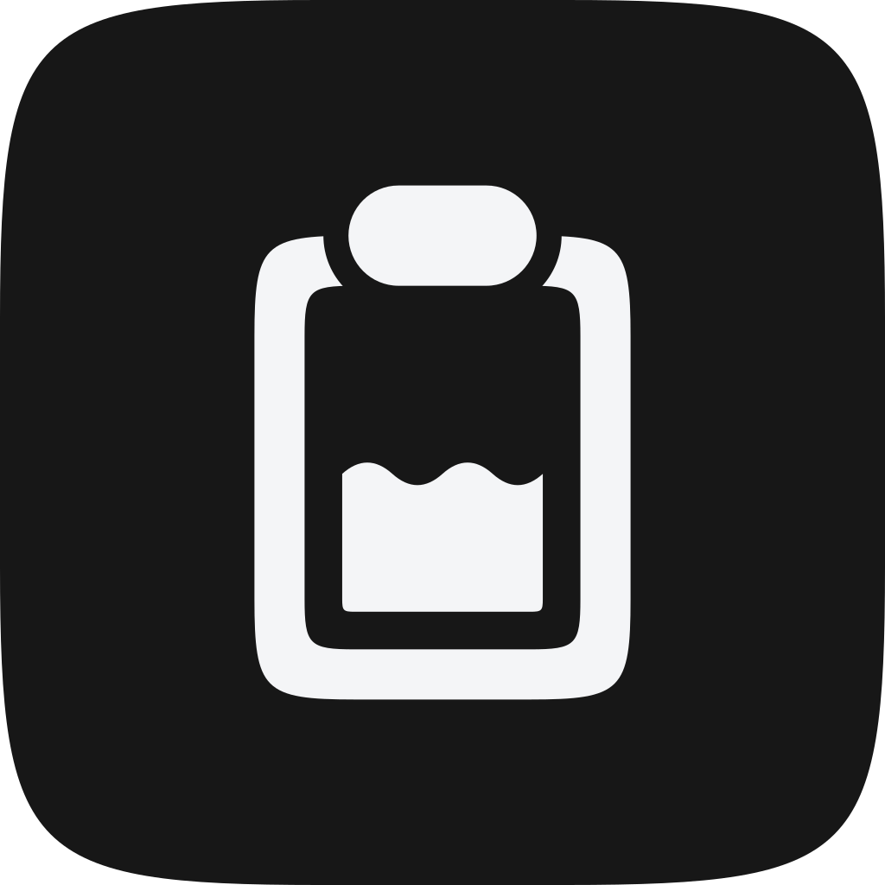
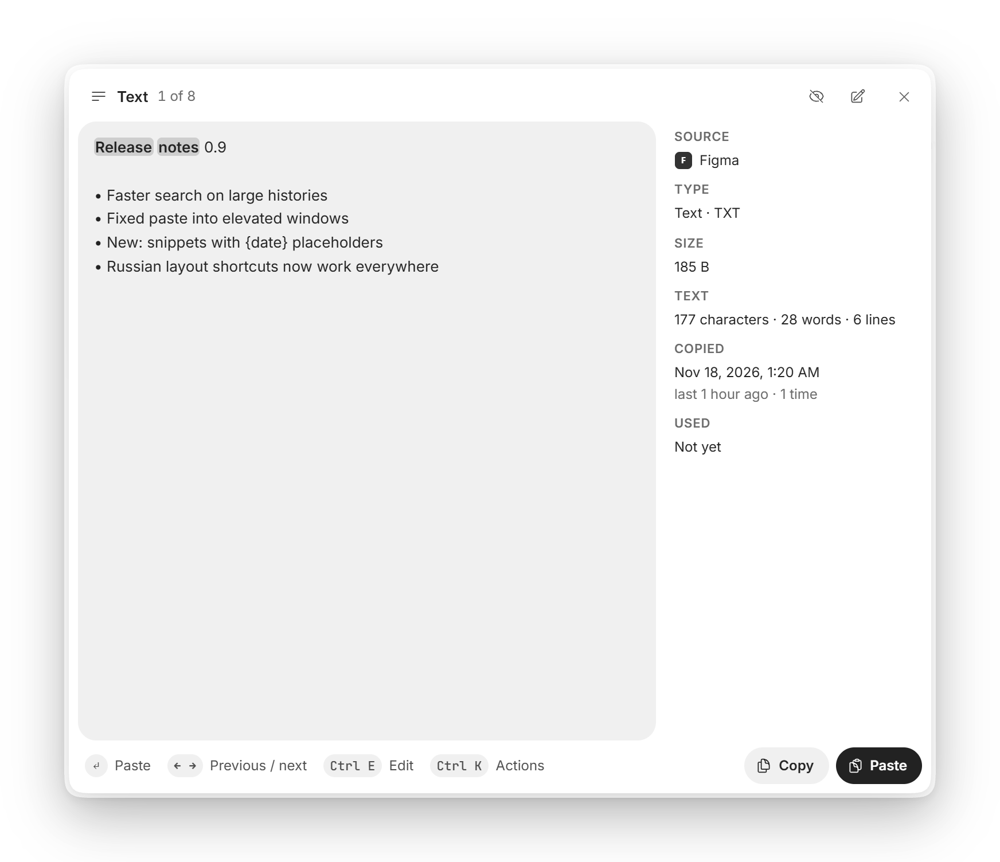
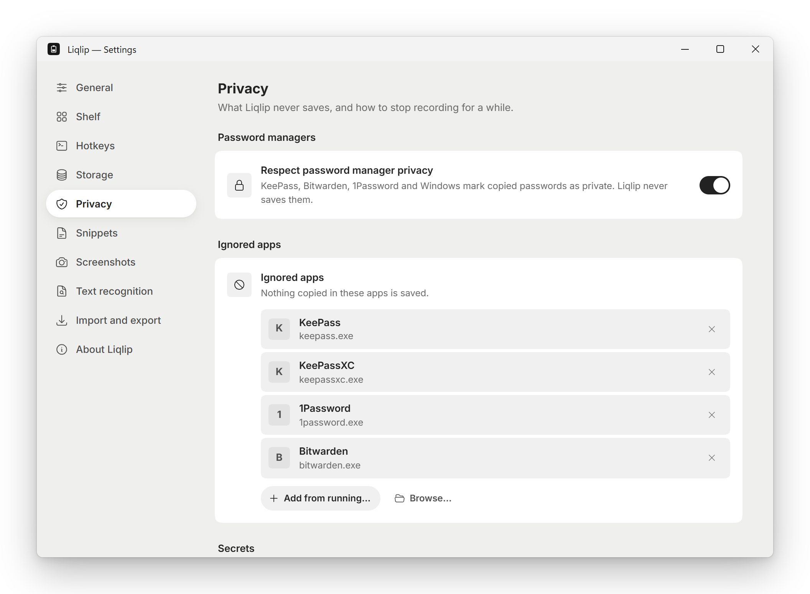
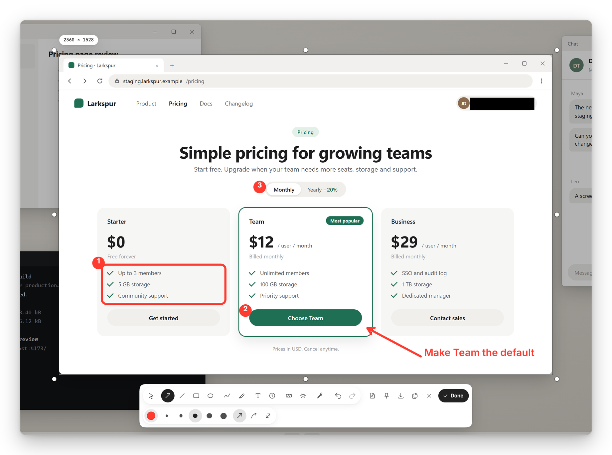
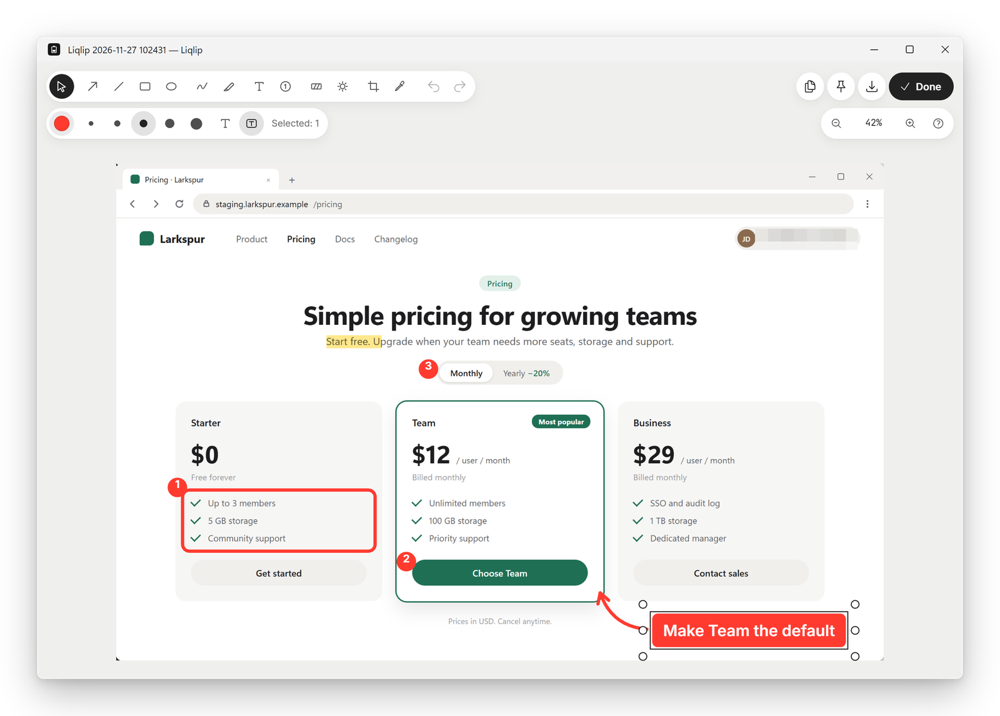
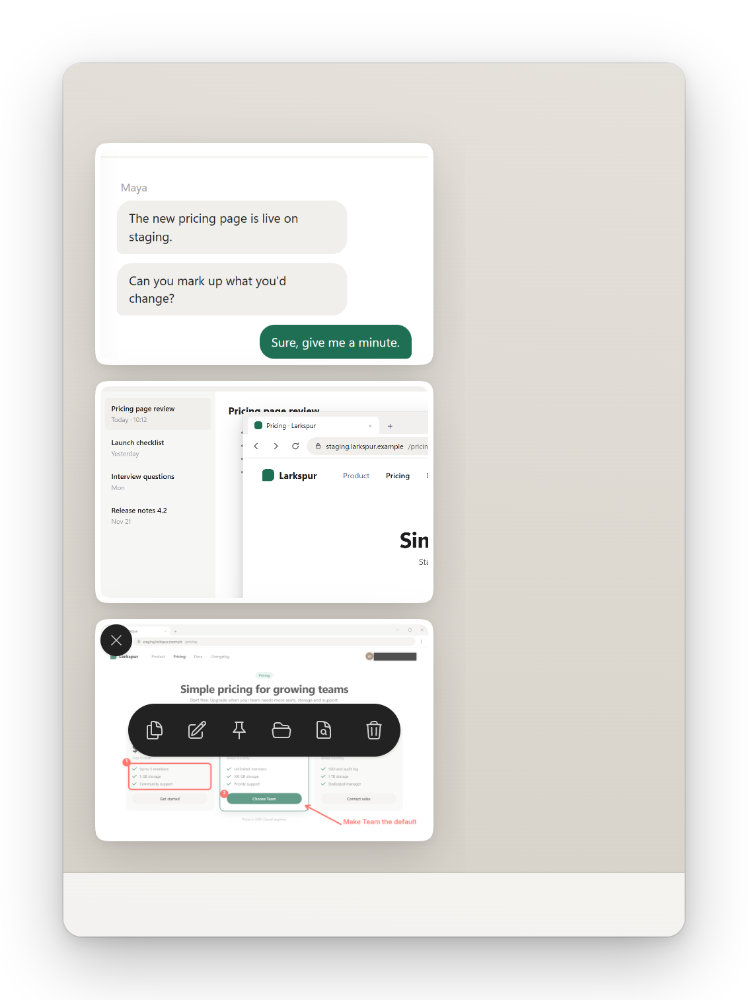

<div align="center">



# Liqlip

**A keyboard-first clipboard manager and screenshot tool for Windows.**<br>
Everything you copy is one `Alt + V` away, and every screenshot one `PrtSc` away: searchable,
private, and stored only on your PC.

[](LICENSE)
[](#install)
[](https://v2.tauri.app)
[](https://svelte.dev)
[](https://github.com/prodbyEDDY/liqlip/actions/workflows/ci.yml)

[Download](https://github.com/prodbyEDDY/liqlip/releases/latest) ·
[Features](#features) ·
[Screenshots](#screenshots) ·
[Shortcuts](#keyboard-shortcuts) ·
[Privacy](#privacy) ·
[Build from source](#build-from-source)

<br>

<picture>
  <source media="(prefers-color-scheme: dark)" srcset="docs/media/shelf-dark.png">
  
</picture>

</div>

## About

Liqlip keeps your clipboard history: text, links, code, colors, contacts, images and files. Press
`Alt + V` in any app and a monochrome shelf of cards opens over it. Start typing to search, or
use the arrow keys and press `Enter`. The item is pasted back into the window you were working
in, at the caret.

Press `PrtSc` and it takes a screenshot. Click a window or drag an area, draw arrows, boxes and
text right on the frozen screen, and press `Enter`. The shot is on the clipboard at once, saved
as a file, and kept in the same history, with annotations you can still move later.

It is free, open source, and makes no network requests. Copies from password managers are never
recorded.

Liqlip started as the clipboard part of Liquid Tools and was rebuilt as a standalone app.
Version 1.1 added screenshots.

## Features

### Clipboard

**Capture**
- Records every copy without polling, using the Windows clipboard listener. A hung source app
  can't freeze Liqlip.
- Seven kinds of items: text, links, code, colors, contacts, images and files. Rich formats
  (HTML, RTF, PNG, file lists) are kept, so you can later paste an item in a specific format.
- Global de-duplication: copying something again moves the existing card to the top instead of
  adding a duplicate.
- Remembers the source app with its icon, so you can filter by it.

**The shelf**
- Instant full-text search with highlighting. Cyrillic and Latin both match case-insensitively.
- Filter tokens with autocomplete: `app:` `type:` `in:` `is:` `date:` `-word`.
- Pills for each type, Favorites, Snippets and your own folders, each with a count.
- 2D keyboard navigation, `Ctrl + 1…9` to paste by position, and multi-select with batch
  actions.
- **Quick Look** (`Space`): the full item with details. Edit text in place with `Ctrl + E`.
- **Actions menu** (`Ctrl + K`): a searchable list of everything you can do with the item,
  including 14 text transforms (case, trim, sort lines, JSON, URL, Base64, slug…).
- Drag cards out of the shelf into other apps. Undo with `Ctrl + Z`.
- Five positions (center, top, bottom, left, right). Light and dark themes.

**Paste**
- Returns focus to the window you came from and releases any held modifier keys before pasting,
  so you never get a stray "v".
- Never types into the wrong window. If the target can't be confirmed, or it runs as
  administrator, the item is copied and a small HUD tells you which shortcut to press.
- A paste shortcut per app (`Ctrl + V`, `Shift + Insert` or your own), for terminals and other
  special cases.
- Plain-text paste, paste as a chosen format, and paste-and-keep-open.

**Organize**
- Favorites with your own order, and folders.
- **Snippets** with placeholders: `{clipboard}`, `{date}`, `{time}`, `{uuid}`,
  `{date format="d MMMM yyyy"}`, `{date offset="+1d"}`, modifiers such as `| trim | uppercase`,
  and `{cursor}` to place the caret after pasting.
- **Paste stack:** queue several items, then press `Alt + Shift + V` to paste them one by one,
  in order, without opening the shelf.
- **OCR:** text in images is recognized in the background with the built-in Windows OCR engine.
  That text becomes searchable, and **Copy text from image** puts it on the clipboard.

**Everything else**
- A classic settings window with ten sections, and a short onboarding.
- Retention by age, by item count and by disk space.
- Backups to a single `.liqlip` file, restored by replacing or by merging without duplicates.
- Read-only import of history from Liquid Tools, screenshots included, safe to repeat.
- Interface in English and Russian.

<table>
  <tr>
    <td width="50%">
      <picture>
        <source media="(prefers-color-scheme: dark)" srcset="docs/media/search-dark.png">
        
      </picture>
      <p align="center"><b>Search with filter tokens</b><br><sub><code>app:telegram</code> becomes a chip; type to narrow further.</sub></p>
    </td>
    <td width="50%">
      <picture>
        <source media="(prefers-color-scheme: dark)" srcset="docs/media/quicklook-dark.png">
        
      </picture>
      <p align="center"><b>Quick Look</b><br><sub>The full item, its source, size and history. <code>Ctrl + E</code> to edit.</sub></p>
    </td>
  </tr>
  <tr>
    <td width="50%">
      <picture>
        <source media="(prefers-color-scheme: dark)" srcset="docs/media/actions-dark.png">
        
      </picture>
      <p align="center"><b>Actions menu</b><br><sub>Every action for the item, searchable, with its shortcut.</sub></p>
    </td>
    <td width="50%">
      <picture>
        <source media="(prefers-color-scheme: dark)" srcset="docs/media/settings-dark.png">
        
      </picture>
      <p align="center"><b>Settings</b><br><sub>A familiar Windows window. Privacy defaults are already on.</sub></p>
    </td>
  </tr>
</table>

### Screenshots

**Capture**
- `PrtSc` freezes every monitor at once, before any Liqlip window appears, and dims the screen
  under the cursor. Until you start selecting, the overlay follows the cursor to another monitor.
- Hover highlights the window under the cursor, down to inner panes such as a browser page or a
  side panel (hold `Alt` for the outer window). Click to take that window, drag for an area
  (`Shift` for a square, `Alt` from the center, hold `Space` to move it), or click the desktop
  for the whole monitor.
- A magnifier with a crosshair and coordinates for pixel-exact edges (`M` to toggle, the mouse
  wheel to zoom), and the live size of the area. Arrow keys move the cursor by one pixel.
- The frame stays adjustable while you draw: its handles sit outside the area, so drawing never
  grabs them, and the tool panel docks beside the frame.
- `Ctrl + PrtSc` takes the screen under the cursor without the overlay. Capturing the active
  window, repeating the last region, copying text from the screen and a 3, 5 or 10 second delay
  are in the tray menu; the first three can also get their own shortcuts. For launchers and
  scripts: `liqlip --capture [region|screen|window|repeat|text]`.

**Annotate**
- Tools: arrow (straight, curved or double), line, rectangle, ellipse, pen, highlighter, text
  (plain or on a colored badge), numbered counters, hide (a solid bar, pixels or blur),
  spotlight and a color picker. `Ctrl + V` pastes an image as an object.
- **A drawing tool always draws.** A press starts a new object, even on top of another one, and
  the tool stays active, so three arrows take three drags. To move or change objects, switch to
  Select (`V`) or hold `Ctrl`; let go and you are drawing again.
- New objects get no box or handles. Changing the color, size or style right after drawing
  applies to the object you just drew, and each tool remembers its own settings.
- Eight color presets plus a custom color, five sizes, outline or fill. Full undo and redo.
- `Esc` never silently throws away your drawing: with objects on the screen, closing asks for a
  second `Esc`.

**After the shot**
- `Enter` copies the shot, saves it to the folder and adds it to your history, then returns
  focus to the window you were in, so `Ctrl + V` pastes it right away. All three are optional.
- A stack of up to four thumbnails in the bottom corner, which never takes focus. Click one to
  edit it, drag it into any app as a PNG file, or hover for **Copy**, **Edit**, **Pin**,
  **Save** (or **Show in folder**), **Text** and **Delete**. It hides after 10 seconds unless you
  hover it; the delay is configurable.
- **Editor window:** the same tools plus a non-destructive crop, zoom and pan. **Done** writes
  the result back into the same history item. Any image from your history opens here too
  (`Ctrl + E` in the shelf).
- **Pin to screen** (`Ctrl + P`): the picture floats above every window. Drag it, zoom with the
  wheel, change opacity with `Ctrl + wheel`. Up to six pins at a time.
- **Copy text from the screen:** select an area and its text goes to the clipboard, recognized
  by Windows OCR. No picture is kept.

**Storage**
- Shots live in the same history as your copies: a **Screenshots** pill, the `type:screenshot`
  token, favorites, folders, retention and backups all apply.
- Annotations are non-destructive. The original picture and the objects are stored separately,
  so **Edit** reopens a shot with arrows and text you can still move.
- Files go to `Pictures\Liqlip`, named `Liqlip {date} {time}` by default (`{app}` and `{n}` are
  available too), as PNG or JPG. The clipboard and the history always get PNG.

<table>
  <tr>
    <td colspan="2">
      <picture>
        <source media="(prefers-color-scheme: dark)" srcset="docs/media/capture-dark.png">
        
      </picture>
      <p align="center"><b>Annotate in place</b><br><sub><code>PrtSc</code>, click a window, draw, press <code>Enter</code>. The panel docks to the frame.</sub></p>
    </td>
  </tr>
  <tr>
    <td width="65%">
      <picture>
        <source media="(prefers-color-scheme: dark)" srcset="docs/media/editor-dark.png">
        
      </picture>
      <p align="center"><b>Editor window</b><br><sub>Open any shot from history; its annotations are still objects.</sub></p>
    </td>
    <td width="35%">
      <picture>
        <source media="(prefers-color-scheme: dark)" srcset="docs/media/qao-dark.png">
        
      </picture>
      <p align="center"><b>Thumbnails</b><br><sub>Click to edit, drag into any app.</sub></p>
    </td>
  </tr>
</table>

<sub>The screen content in these pictures is made up.</sub>

## Keyboard shortcuts

**Global**

| Keys | Action |
|---|---|
| `Alt + V` | Open or close the shelf |
| `Alt + Shift + V` | Paste the next item from the paste stack |
| `PrtSc` | Screenshot: pick a window or an area |
| `Ctrl + PrtSc` | Screenshot of the screen under the cursor |

All of them are configurable. You can also bind *Pause recording*, *Skip next copy*, *Active
window*, *Repeat last region* and *Copy text from the screen*.

> **Windows 11 and `PrtSc`.** Windows can hand the Print Screen key to its Snipping Tool, and
> then Liqlip doesn't get it. When that happens, Settings → Screenshots and the onboarding show
> a notice with **Open Windows Settings** and **Assign another shortcut**. To give the key back,
> turn off *Use the Print screen key to open screen capture* in Windows Settings →
> Accessibility → Keyboard (older builds call it *screen snipping*). Liqlip never changes this
> setting for you.

**In the shelf**

| Keys | Action |
|---|---|
| *type* | Search |
| `↑ ↓ ← →` · `PgUp` `PgDn` · `Home` `End` | Move through the cards |
| `Enter` | Paste into the previous window |
| `Shift + Enter` | Paste as plain text |
| `Alt + Enter` | Paste and keep the shelf open |
| `Ctrl + Enter` | Copy only |
| `Ctrl + 1…9` | Paste the N-th visible card |
| `Space` · `Ctrl + Y` | Quick Look |
| `Ctrl + K` · right-click | Actions menu |
| `Ctrl + D` | Add to or remove from favorites |
| `F2` · `Ctrl + E` | Rename · edit (pictures open in the editor) |
| `Ctrl + P` | Pin a picture to the screen |
| `Ctrl + O` · `Ctrl + Shift + O` | Open · show in Explorer |
| `Delete` · `Ctrl + Z` | Delete · undo |
| `Ctrl + A` · `Shift + arrows` | Select all · extend the selection |
| `Ctrl + Shift + S` | Add to the paste stack |
| `Ctrl + Tab` · `Alt + 1…9` | Next pill · pill N |
| `Ctrl + ,` | Settings |
| `Esc` | Step back: close a layer, clear the selection, clear the search, close the shelf |

**Screenshot overlay: picking a target**

| Keys | Action |
|---|---|
| click · drag | Take the window under the cursor · select an area |
| `Shift` · `Alt` · hold `Space` | While dragging: square · from the center · move the area |
| `↑ ↓ ← →` · `Enter` | Move the cursor by 1 px (`Shift`: 10 px) · start and finish an area |
| `F` · `R` | Whole screen · last region |
| `M` · mouse wheel | Magnifier on or off · zoom |
| `Esc` | Close the overlay |

**Screenshot overlay: with the frame**

| Keys | Action |
|---|---|
| `Enter` | Done: copy, save and keep the shot, as set in Settings |
| `Ctrl + C` · `Ctrl + S` · `Ctrl + Shift + S` | Copy, no file · save to the folder, no copy · save as… |
| `Ctrl + P` | Pin to the screen |
| `Ctrl + arrows` · `Alt + arrows` | Move the frame · resize it (`Shift`: 10 px) |
| `Esc` | Step back: the current gesture, text, selection, the Select tool, then close |

**Annotation tools** (in the overlay and in the editor window)

| Keys | Action |
|---|---|
| `V` | Select |
| `A` · `L` | Arrow · line |
| `R` · `E` | Rectangle · ellipse |
| `P` · `H` | Pen · highlighter |
| `T` · `N` | Text · counter |
| `B` · `S` | Hide (`Shift + B`: next style) · spotlight |
| `C` · `I` | Crop (editor window) · color picker |
| hold `Ctrl` | Select for a moment, then keep drawing |
| `1…5` · `[` `]` | Size |
| `Shift + 1…8` | Color preset |
| `F` | Outline or fill |
| `Delete` · `Ctrl + D` · `Ctrl + A` | Delete · duplicate · select all |
| `Ctrl + Z` · `Ctrl + Y` | Undo · redo |
| `Enter` | Done |
| `Esc` | Finish the text, clear the selection, back to Select |
| `?` | All shortcuts |

In the editor window, hold `Space` or the middle button to pan; `Ctrl + wheel` or `Ctrl + =` and
`Ctrl + -` zoom, `Ctrl + 0` fits the picture and `Ctrl + 1` shows it at 100 %.

Shortcuts are matched by physical key, so they work the same in the Russian keyboard layout.

## Search syntax

| Token | Example | Finds |
|---|---|---|
| `app:` | `app:chrome` | Items copied from an app |
| `type:` | `type:code` | `text` `link` `code` `color` `contact` `image` `screenshot` `file` |
| `in:` | `in:work` | Items in a folder |
| `is:` | `is:fav` · `is:snippet` | Favorites · snippets |
| `date:` | `date:today` | `today` `yesterday` `week` `month` |
| `-word` | `-draft` | Excludes items containing the word |

Typing `:` opens suggestions, and each token turns into a chip. Search covers the full text,
titles, URLs, file names and recognized image text.

## Privacy

Liqlip is private by default. Every protection below is on out of the box:

- **Password managers.** Copies marked private by Windows are ignored
  (`ExcludeClipboardContentFromMonitorProcessing`, `CanIncludeInClipboardHistory`,
  `CanUploadToCloudClipboard`, `Clipboard Viewer Ignore`). This covers KeePass, KeePassXC,
  Bitwarden and Windows' own dialogs.
- **Ignored apps.** Nothing copied in these apps is saved. The list starts with KeePass,
  KeePassXC, 1Password and Bitwarden, and you can add any app.
- **Looks like a secret.** A copy that is entirely a card number (Luhn-checked), an API key with
  a known prefix (`sk-`, `ghp_`, `github_pat_`, `xoxb-`, `AKIA…`, `AIza…`) or a PEM private key
  is not saved.
- **Pause, skip and delete.** Pause recording for a while, skip the next copy, or delete
  everything from the last 5 minutes to 24 hours. Deleted items leave no traces on disk.
- **Screenshots stay on your PC.** A shot goes only to the clipboard, your history and the
  folder you chose. There is no upload, no cloud and no share link.
- **Out of other apps' recordings.** The capture overlay and the thumbnails are excluded from
  screen recording and screen sharing by other apps. Pinned pictures stay visible, since you pin
  them to show them.
- **Local only.** History lives in a SQLite database in `%APPDATA%\com.liqlip.app`. Liqlip makes
  no network requests, and its logs never contain what you copy.

## Install

1. Download `Liqlip_1.1.0_x64-setup.exe` from
   [Releases](https://github.com/prodbyEDDY/liqlip/releases/latest).
2. Run it. No administrator rights are needed: it installs per user into `%LOCALAPPDATA%\Liqlip`.
   The installer isn't code-signed, so SmartScreen may warn you. Choose **More info → Run
   anyway**.
3. Press `Alt + V`. The first launch opens a short onboarding: hotkey, privacy, screenshots and
   an optional import.

Liqlip starts with Windows; you can turn that off in Settings → General. WebView2 is part of
Windows 10 and 11. If it's missing, the installer downloads it.

**Uninstall:** Settings → Apps → Installed apps → Liqlip. Tick **Delete the application data**
to also remove your history and settings.

## Build from source

Requirements: Windows 10 or 11, [Node.js](https://nodejs.org) 24+, [pnpm](https://pnpm.io) 12+,
[Rust](https://rustup.rs) 1.90+ (MSVC toolchain) and the
[Tauri prerequisites](https://v2.tauri.app/start/prerequisites/).

```bash
pnpm install
pnpm tauri dev      # run the app
pnpm tauri build    # → src-tauri/target/release/bundle/nsis/Liqlip_<version>_x64-setup.exe
```

**UI without the native app.** `pnpm dev` serves the UI at `http://localhost:1430` with an
in-memory mock backend, so the shelf, settings and the screenshot windows work in a normal
browser:
- `/picker.html`
- `/settings.html`
- `/hud.html?kind=copied`
- `/capture.html` (a made-up desktop to capture), `/editor.html`, `/shots.html`,
  `/pin.html?clip=<id>`

Flags such as `?mock-empty=1`, `?mock-error=1`, `?mock-position=bottom` and `?mock-scale=1.5`
show other states; the full list is in [`src/lib/ipc/mock/bus.ts`](src/lib/ipc/mock/bus.ts).

**Checks** (the same ones CI runs):

```bash
pnpm check                                          # svelte-check: 0 errors, 0 warnings
pnpm test                                           # node:test, incl. the TS ↔ Rust contract guard
pnpm build                                          # type check + production frontend build
cargo test --manifest-path src-tauri/Cargo.toml     # Rust unit tests
```

## Project structure

```
src-tauri/src/
  capture/     clipboard listener, snapshot, privacy markers, classification
  store/       SQLite (WAL, FTS5 trigram), feed, retention, media, backups, screenshots
  paste/       focus handling, SendInput, per-app paste shortcuts, paste stack, drag-out
  picker/      shelf window state machine, docking, HUD
  hotkeys/     global hotkeys and the shortcut recorder
  ocr/         Windows.Media.Ocr background queue
  import/      Liquid Tools import, .liqlip backups
  screenshot/  screen freeze, window tree, capture sessions, commit, files, and the
               thumbnail, editor and pin windows
src/
  windows/picker/     the shelf (Svelte 5): grid, search, Quick Look, actions, snippets
  windows/settings/   settings window and onboarding
  windows/hud/        paste / copy toasts
  windows/capture/    the screenshot overlay: window or area, frame, tool panel
  windows/shots/      thumbnails after a shot
  windows/editor/     the editor window
  windows/pin/        pictures pinned to the screen
  lib/editor/         the annotation editor shared by the overlay and the editor window
  lib/                IPC contract and mock, i18n (EN + RU), components, snippet engine
docs/                 spec, architecture, design system (in Russian)
```

**Stack:** Tauri 2, Rust, Svelte 5 (runes), Vite, Tailwind CSS 4, TypeScript. On the Rust side:
`rusqlite` (bundled SQLite with FTS5), `windows` (Win32 and WinRT) and `image`. Fonts are Inter
and JetBrains Mono; icons are Heroicons.

## Documentation

Developer docs are in [`docs/`](docs/), written in Russian:
- [SPEC](docs/SPEC.md): every surface, key, action and setting.
- [ARCHITECTURE](docs/ARCHITECTURE.md): windows, SQLite schema, the capture, paste, hotkey and
  screenshot pipelines, and the IPC contract.
- [Design system](docs/design-system.md).
- [ROADMAP](docs/ROADMAP.md).

[`CLAUDE.md`](CLAUDE.md) holds the hard rules for contributors and coding agents.

## Known limitations

- **No auto-update and no code signing yet.** To update, install a newer version over the old
  one; your history is kept.
- **OCR quality depends on the Windows language pack.** In *System* mode, Windows may pick a
  non-English engine that misreads Latin text. For English screenshots, choose English in
  Settings → Text recognition.
- **Very short search terms.** Terms of one or two characters match titles and previews rather
  than the full text, because the full-text index works on trigrams.
- **Built-in `Shift + Insert` paste** applies only to mintty and PuTTY. For other terminals,
  set a per-app paste shortcut in Settings.
- **Screenshots are still images.** There is no scrolling capture, no video or GIF recording and
  no cloud upload, and the mouse cursor isn't captured. An area can't span two monitors.
- **Capture uses GDI.** On HDR displays and for DRM-protected video, parts of a shot may come
  out dark or black.

## Contributing

Issues and pull requests are welcome. See [CONTRIBUTING.md](CONTRIBUTING.md) for the dev setup,
the checks and the house rules. To report a vulnerability, see [SECURITY.md](SECURITY.md).

## License

[MIT](LICENSE) © 2026 prodbyEDDY

Third-party components keep their own licenses; see
[`public/licenses/THIRD-PARTY.txt`](public/licenses/THIRD-PARTY.txt). Icons are
[Heroicons](https://heroicons.com) (MIT).
